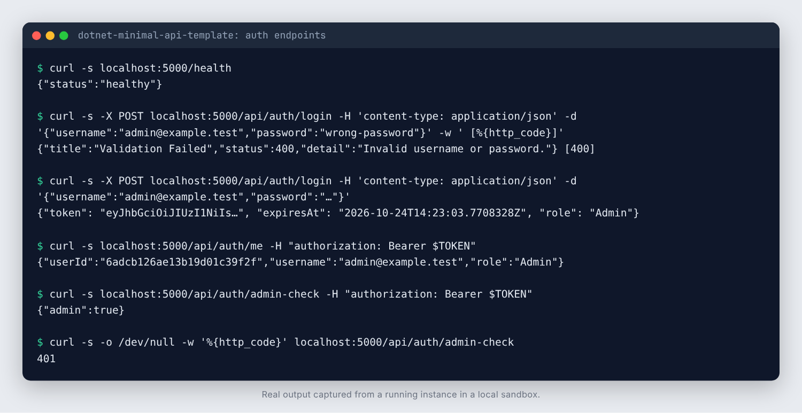

# ProjectName

Starter template for a .NET 10 minimal API backed by MongoDB, with JWT
authentication, Testcontainers-based integration tests and CI. Tenancy and a
background-worker host are included as optional folders.

## Screenshots



_Real output from a local run of the built API (.NET 10, Development environment, seeded admin) against FerretDB, a MongoDB-compatible server backed by PostgreSQL, because a MongoDB server was not available in the sandbox. The JWT is shortened and the password is redacted in the login line. FerretDB is not MongoDB, so use the Testcontainers suite (real MongoDB) as the reference for database behaviour._

## What is included

- `src/ProjectName.Api`: minimal API.
  - `Auth/`: JWT issuing (`JwtTokenService`), startup guard against the dev
    placeholder secret (`JwtSecretGuard`), BCrypt `PasswordHasher`, claim names,
    the `Admin` policy.
  - `Endpoints/`: `POST /api/auth/login` (rate limited), `GET /api/auth/me`,
    `GET /api/auth/admin-check`, `GET /health`.
  - `Infrastructure/`: Mongo context, camelCase convention, index initializer,
    login rate limiting, ProblemDetails exception handler, OpenAPI bearer scheme
    (Scalar UI at `/scalar` in Development), optional development admin seeder.
  - `Domain/`, `Repositories/`, `Services/`, `Dtos/`: a `User` entity and the
    login flow, as the pattern to copy.
- `tests/ProjectName.UnitTests`: JWT, password hashing, rate limiting, tenant
  context and worker tests. No external dependencies.
- `tests/ProjectName.IntegrationTests`: the real API against a real MongoDB via
  Testcontainers (`ApiFactory`, `MongoContainerFixture`). Needs Docker.
- `Dockerfile`, `Dockerfile.worker`, `docker-compose.yml`.
- GitHub Actions: build, format check, tests, Docker build, gitleaks, CodeQL (C#
  and Actions), NuGet vulnerability scan. Dependabot for NuGet, Actions, Docker.

### Optional folders

| Folder | Purpose | Remove by |
| --- | --- | --- |
| `src/ProjectName.Api/Tenancy/` | Per-request tenant context from the JWT, tenant collection | See `Tenancy/README.md` |
| `workers/ProjectName.Worker/` | Background-service host with a periodic worker | See `workers/ProjectName.Worker/README.md` |

## Start a new project from this template

```bash
./rename.sh Acme.Orders     # renames namespaces, projects, folders, Docker/env names; deletes itself
```

Then edit `LICENSE` (year and holder) and `docs/project-memory/01-brief.md`.

## Run

```bash
export PROJECTNAME_JWT_SECRET=$(openssl rand -base64 48)
export PROJECTNAME_SEED_ADMIN_PASSWORD='choose-a-dev-password'   # optional
docker compose up --build
```

(after renaming, the variable prefix follows your name, for example
`ACME_ORDERS_JWT_SECRET`.) API at `http://localhost:8080`, docs at `/scalar`.

```bash
curl -X POST http://localhost:8080/api/auth/login \
  -H 'Content-Type: application/json' \
  -d '{"username":"admin@example.test","password":"<your seed password>"}'
```

Without Docker: run MongoDB locally and
`dotnet run --project src/ProjectName.Api` (Development uses the placeholder
secret in `appsettings.Development.json`; Production refuses to start with it).

## Checks

```bash
dotnet build ProjectName.slnx --configuration Release
dotnet format ProjectName.slnx --verify-no-changes --severity warn
dotnet test tests/ProjectName.UnitTests/ProjectName.UnitTests.csproj
dotnet test tests/ProjectName.IntegrationTests/ProjectName.IntegrationTests.csproj   # needs Docker
```

## Security

See `SECURITY.md`. Dated vulnerability-scanner exemptions go in
`osv-scanner.toml`; the CI NuGet scan fails on any vulnerable package.
